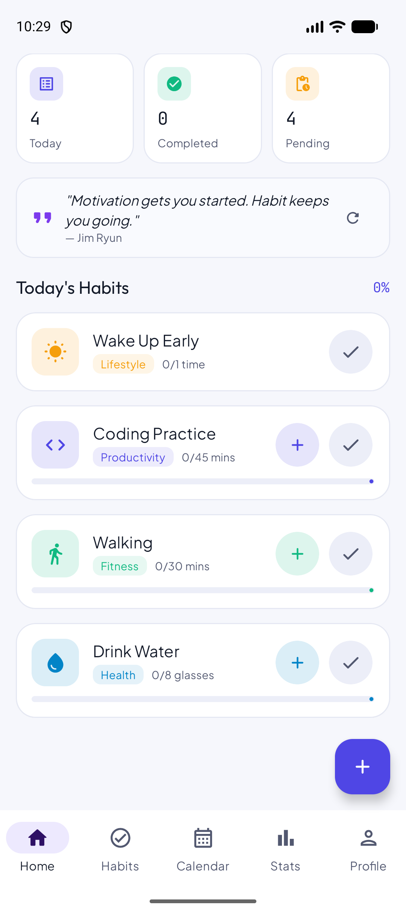
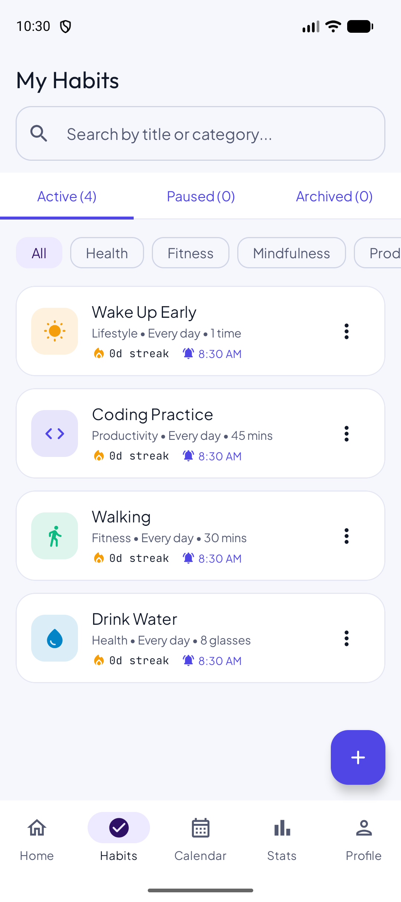
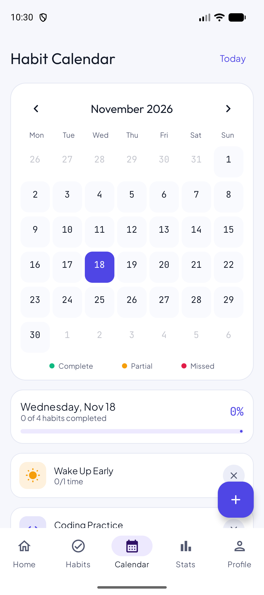
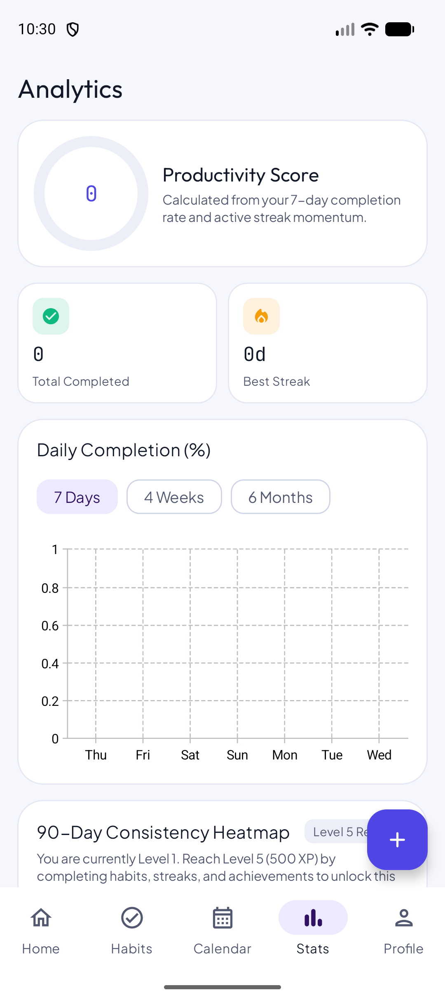

# 🌊 HabitFlow – Smart Offline Habit Tracker & Gamified Productivity App

[](https://developer.android.com/)
[](https://kotlinlang.org/)
[](https://developer.android.com/jetpack/compose)
[](https://dagger.dev/hilt/)
[](https://developer.android.com/training/data-storage/room)
[](LICENSE)

**HabitFlow** is a modern, gamified, offline-first Android habit tracking application built with **Kotlin**, **Jetpack Compose**, **Material Design 3**, **Room Database**, **Dagger Hilt**, **WorkManager**, and **Vico Charts**.

Transform your daily routines into rewarding milestones. Track habits, level up your profile, earn achievements, analyze productivity trends with interactive charts, and keep 100% of your data safe on your device.

---

## 📥 Download APK (Direct Download)

Click the link below to download the latest compiled **Debug APK** directly to your Android device:

<div align="center">

### 🚀 [**Click Here to Download HabitFlow APK (`app-debug.apk`)**](https://raw.githubusercontent.com/omsoni21/habitflow/main/app/build/outputs/apk/debug/app-debug.apk)

*Alternative link: [GitHub Direct Raw APK Link](https://github.com/omsoni21/habitflow/raw/main/app/build/outputs/apk/debug/app-debug.apk)*

</div>

> [!TIP]
> ### 📲 Quick Installation Guide:
> 1. Tap the **Download APK** link above on your Android phone/tablet (Android 7.0 or higher).
> 2. Open the downloaded `app-debug.apk` file from your browser downloads or File Manager.
> 3. If prompted by Android, grant permission for **"Install apps from unknown sources"**.
> 4. Tap **Install**, open **HabitFlow**, and start building your daily habits!

---

## 📱 App Screenshots Gallery

<div align="center">

| 🏠 Home Dashboard | 📋 Habit Management | 📅 Interactive Calendar |
| :---: | :---: | :---: |
|  |  |  |
| *Level XP, Daily Progress Ring & Habits* | *Full Habit List & Fast Logging* | *Monthly View & Consistency Colors* |

<br/>

| 📊 Visual Analytics | 🏆 Profile & Achievements |
| :---: | :---: |
|  |  |
| *Vico Charts & Productivity Score* | *Level Unlocks & Data Backup* |

</div>

---

## ✨ Key Features & Highlights

### 🎯 **Smart Habit Tracking & Flexible Goals**
- **Custom Goal Targets**: Set habits with count/time goals (e.g., *8 glasses of water*, *45 mins coding*, *30 mins reading*).
- **Flexible Frequencies**: Daily, specific weekdays, or custom interval schedules.
- **Rich Personalization**: Choose from 16 custom icons and 10 vibrant accent colors.
- **Quick-Fill Catalog**: 10 curated habit suggestions (*Wake Up Early*, *Drink Water*, *Read Books*, *Exercise*, *Meditation*, etc.).

### 🏆 **Gamification & XP Progression**
- **Level Progression System**: Earn XP for completing daily habits and level up from *Seedling* to *Habit Master*.
- **Milestone Achievements**: Unlock celebratory badges (*First Step*, *3-Day Streak*, *30-Day Master*, *100 Habits Completed*).
- **Dynamic Reward Themes**: Unlock special custom app theme palettes as you level up.
- **Celebration Overlays**: Interactive confetti particle animations when completing milestone habits.

### 📊 **Visual Analytics & Interactive Charts**
- **Vico Compose Charts**: Interactive 7-Day, 4-Week, and 6-Month completion trend bar & line graphs.
- **Productivity Gauge Score**: Real-time calculated overall productivity rating based on consistency.
- **Consistency Breakdown**: Highlight your most and least consistent habits to adjust routines.

### 📅 **Interactive Calendar Heatmap**
- **Full Monthly Overview**: Color-coded completion indicators for every day of the month.
- **Flexible Week Start**: Respects user's preferred start of week (Monday or Sunday).
- **Retroactive Logging**: Log or adjust past habit entries easily from the calendar view.

### 🔔 **Reliable Local Reminders**
- **Offline Notifications**: Powered by WorkManager and AlarmManager with custom reminder times per habit.
- **Boot & Timezone Resilience**: `BootCompletedReceiver` automatically reschedules reminders after device reboot.

### 🔒 **100% Offline & Complete Data Privacy**
- **Zero Cloud / Zero Ads / Zero Tracking**: Your data stays strictly on your physical device.
- **Full JSON Backup & Restore**: Effortlessly backup or restore your habits using Storage Access Framework.
- **CSV Export**: Export your complete history to `.csv` for custom spreadsheet analysis.

---

## 🛠️ Tech Stack & Dependencies

| Layer | Technology / Library |
| :--- | :--- |
| **Language** | Kotlin 2.0+ (Modern Coroutines & Flow) |
| **UI Framework** | Jetpack Compose + Material Design 3 |
| **Architecture** | MVVM + Clean Architecture + Repository Pattern |
| **Dependency Injection** | Dagger Hilt 2.5x |
| **Local Database** | Room Database (Flow reactive queries) |
| **Preferences** | DataStore Preferences |
| **Charts & Graphs** | Vico Compose M3 Library |
| **Background Tasks** | WorkManager + AlarmManager + BroadcastReceivers |
| **Navigation** | Navigation Compose (Type-safe routes) |
| **Unit & UI Testing** | JUnit4, Robolectric, Compose UI Test Framework |

---

## 📁 Architecture & Project Structure

```
com.example
├── data/
│   ├── dao/          # Room DAOs with Flow reactive queries
│   ├── database/     # HabitFlowDatabase & Room Converters
│   ├── entity/       # HabitEntity, HabitCompletionEntity, AchievementEntity
│   ├── local/        # UserPreferencesRepository (DataStore)
│   └── repository/   # HabitRepository & GamificationRepository
├── domain/
│   ├── model/        # Domain models, enums & state interfaces
│   └── usecase/      # StreakCalculator, GamificationEngine, BackupAndExportManager
├── di/               # Hilt Dependency Injection Modules
├── navigation/       # Type-safe Navigation Compose graph & routes
├── notifications/    # WorkManager Workers, NotificationHelper, BootCompletedReceiver
├── presentation/     # MVVM ViewModels & Jetpack Compose UI Screens
│   ├── onboarding/   # Guided introductory screens
│   ├── home/         # Dashboard with level XP & daily habits
│   ├── habits/       # Habit list & Add/Edit screens
│   ├── calendar/     # Interactive completion calendar
│   ├── statistics/   # Vico charts & productivity metrics
│   ├── achievements/ # Unlocked badges & level rewards
│   └── profile/      # User settings & backup/export
└── ui/theme/         # Material 3 Color palette, typography & dynamic themes
```

---

## ⚡ Setup & Local Build Instructions

### Prerequisites
- **Android Studio**: Ladybug / Meerkat or newer (JDK 17+)
- **Android SDK**: API Level 36 (Min SDK 24 / Android 7.0+)

### Step-by-Step Clone & Build:
```bash
# 1. Clone the repository
git clone https://github.com/omsoni21/habitflow.git
cd habitflow

# 2. Build the Debug APK
./gradlew :app:assembleDebug

# 3. Run Unit & Robolectric Tests
./gradlew :app:testDebugUnitTest
```

The output APK will be generated at:  
`app/build/outputs/apk/debug/app-debug.apk`

---

## 📄 License

Distributed under the **MIT License**. See `LICENSE` for more information.

---

<div align="center">

Developed with ❤️ for building better daily habits and personal growth.

**[⬆ Back to Top](#-habitflow--smart-offline-habit-tracker--gamified-productivity-app)**

</div>
