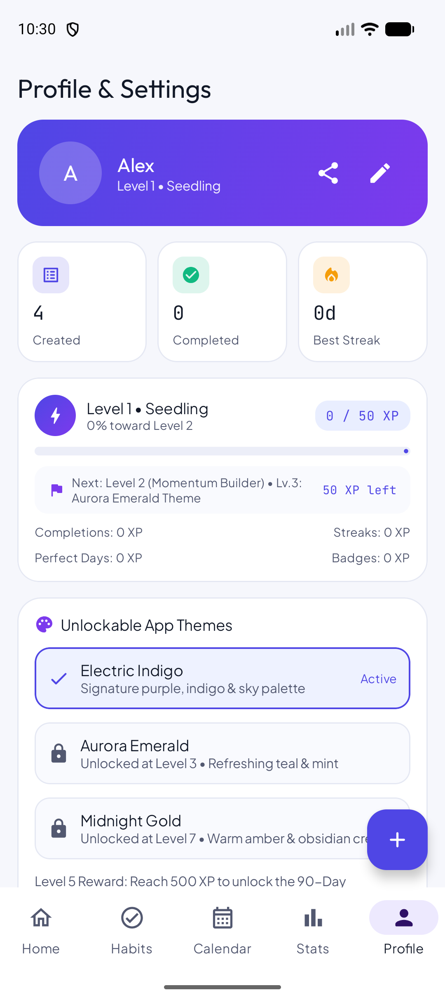

# 🌊 HabitFlow – Smart Habit Tracker

[](https://developer.android.com/)
[](https://kotlinlang.org/)
[](https://developer.android.com/jetpack/compose)
[](https://dagger.dev/hilt/)
[](https://developer.android.com/training/data-storage/room)

**HabitFlow** is a modern, gamified, offline-first Android habit tracking application built with **Kotlin**, **Jetpack Compose**, **Material Design 3**, **Room**, **Dagger Hilt**, **WorkManager**, and **Vico Charts**. 

Build small daily rituals, level up your profile, earn milestone achievements, and master your habits with complete data privacy.

---

## 📥 Download APK

You can download the latest pre-built **Debug APK** directly from GitHub or build it locally:

- 🚀 **Direct Download**: [Download Latest APK (`app-debug.apk`)](https://github.com/omsoni21/habitflow/raw/main/app/build/outputs/apk/debug/app-debug.apk)
- 📦 **GitHub Releases**: [HabitFlow Releases Page](https://github.com/omsoni21/habitflow/releases)

#### Installation Instructions:
1. Download the `app-debug.apk` file on your Android device.
2. Tap the downloaded file to install it.
3. If prompted, enable **"Install from unknown sources"** in your device settings.

---

## 📱 App Screenshots

<div align="center">

| 🏠 Home Dashboard | 📋 Habit Management | 📅 Interactive Calendar |
| :---: | :---: | :---: |
|  |  |  |

| 📊 Analytics & Charts | 🏆 Profile & Achievements |
| :---: | :---: |
|  |  |

</div>

---

## ✨ Key Features

- 🎯 **Smart Habit Tracking**:
  - Daily, weekly, and custom-interval habit schedules.
  - Quick progress logging with target goals (e.g., 8 glasses of water, 45 mins coding).
  - 10 curated quick-fill suggestions, 16 custom icons, 10 vibrant accent colors.

- 🏆 **Gamification & Milestone Badges**:
  - XP progression system with level unlocks and custom theme rewards.
  - Unlockable achievement badges (*First Step*, *3-Day Streak*, *30-Day Master*, *100 Habits Completed*).
  - Animated level progress bars and instant celebration overlays.

- 📊 **Visual Analytics & Reports**:
  - Interactive **Vico charts** (7-Day, 4-Week, and 6-Month completion trends).
  - Overall productivity score gauge and habit consistency breakdown.

- 📅 **Calendar Heatmap**:
  - Full monthly calendar view respecting user's preferred start of week (Monday/Sunday).
  - Color-coded daily completion indicators with per-day logging history.

- 🔔 **Smart Local Reminders**:
  - WorkManager-powered offline notifications.
  - `BootCompletedReceiver` automatic rescheduling on device restart.

- 🔒 **100% Offline & Private**:
  - Zero cloud dependency, zero ads, zero data tracking.
  - JSON full backup/restore and CSV history export via Storage Access Framework.

---

## 🛠️ Tech Stack & Architecture

- **Language**: Kotlin 2.x
- **UI Framework**: Jetpack Compose with Material Design 3
- **Architecture**: MVVM + Clean Architecture + Repository Pattern
- **Dependency Injection**: Dagger Hilt
- **Local Storage**: Room Database + Flow queries
- **Preferences**: DataStore Preferences
- **Charts**: Vico Compose M3 Library
- **Background Tasks**: WorkManager + AlarmManager
- **Testing**: JUnit4, Robolectric, Compose UI Test

```
com.example
├── data/
│   ├── dao/          # Room DAOs with Flow queries
│   ├── database/     # HabitFlowDatabase
│   ├── entity/       # HabitEntity, HabitCompletionEntity, AchievementEntity
│   ├── local/        # UserPreferencesRepository (DataStore)
│   └── repository/   # HabitRepository & GamificationRepository
├── domain/
│   ├── model/        # Core domain models & enums
│   └── usecase/      # StreakCalculator, GamificationEngine, BackupAndExportManager
├── di/               # Hilt Dependency Injection Modules
├── navigation/       # Type-safe Navigation Compose graph
├── notifications/    # WorkManager Workers, NotificationHelper, BootCompletedReceiver
├── presentation/     # MVVM ViewModels & Jetpack Compose UI Screens
│   ├── onboarding/   # Guided introductory screens
│   ├── home/         # Dashboard with level XP & daily habits
│   ├── habits/       # Habit list & Add/Edit screens
│   ├── calendar/     # Interactive completion calendar
│   ├── statistics/   # Vico charts & productivity metrics
│   ├── achievements/ # Unlocked badges & level rewards
│   └── profile/      # User settings & backup/export
└── ui/theme/         # Custom Material 3 palette, typography & dynamic themes
```

---

## ⚡ Setup & Build Instructions

### Prerequisites
- **Android Studio**: Meerkat or newer (JDK 17+)
- **Android SDK**: API Level 36 (Min SDK 24 / Android 7.0)

### Clone & Build
```bash
# Clone the repository
git clone https://github.com/omsoni21/habitflow.git
cd habitflow

# Build Debug APK
./gradlew :app:assembleDebug
```

The output APK will be generated at:  
`app/build/outputs/apk/debug/app-debug.apk`

---

## 📄 License

Distributed under the MIT License. See `LICENSE` for more information.

---

<div align="center">
  Developed with ❤️ for building better daily habits.
</div>
